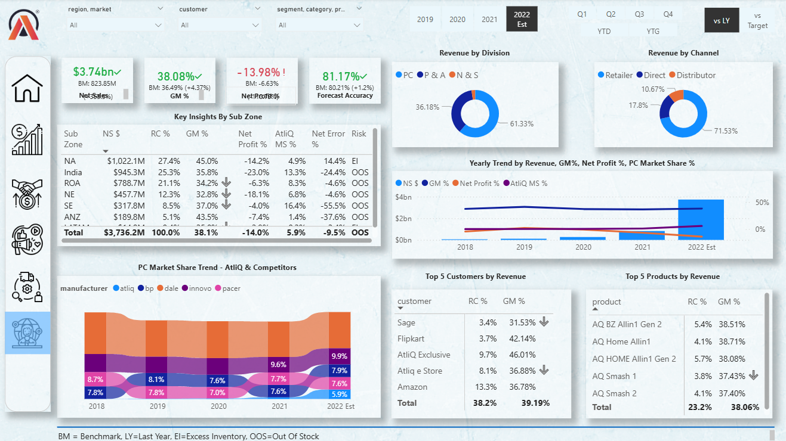
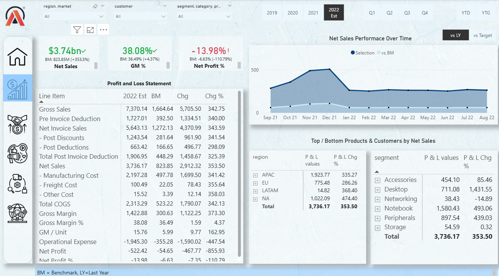
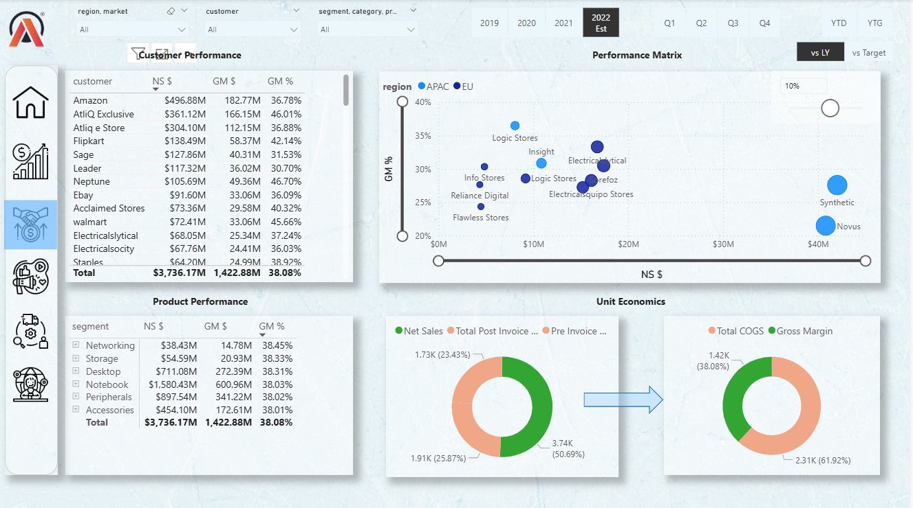
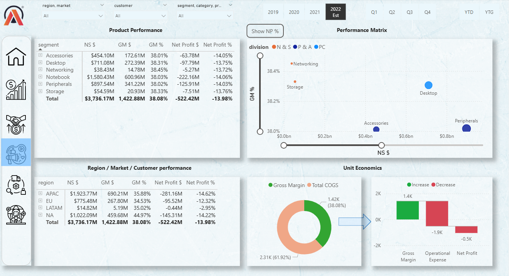
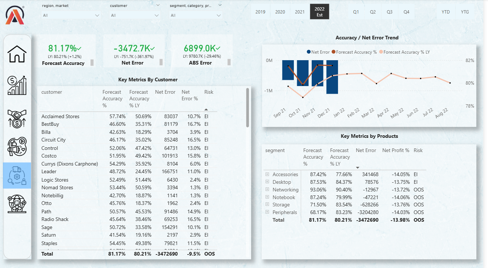

# 📊 AtliQ Hardware – Business Insights 360 | Power BI Project

**An end-to-end Business Intelligence solution for analyzing Finance, Sales, Marketing, Supply Chain and Executive performance.**

Business Insights 360 is an interactive Power BI dashboard built around the AtliQ Hardware business case. It integrates multiple business functions into a unified reporting environment, enabling stakeholders to analyze financial performance, customer and product contribution, regional profitability, forecast accuracy and inventory risks.

The objective is not just to visualize data, but to transform business metrics into actionable insights that support better decision-making.

---

## 📌 Project Overview

| Project Detail | Description |
|---|---|
| Project Name | AtliQ Hardware – Business Insights 360 |
| Domain | Business Intelligence & Analytics |
| Industry | Consumer Electronics / Hardware |
| Primary Tool | Microsoft Power BI |
| Data Preparation | Power Query |
| Calculations | DAX |
| Querying | SQL |
| Data Modeling | Star Schema |
| Reporting Currency | USD |
| Report Period | 2022 Estimate with historical comparisons |

## 🎯 Project Objectives

- Develop a consolidated view of organizational performance.
- Analyze financial performance through Profit & Loss reporting.
- Evaluate customer and product profitability.
- Identify regional and market-level business opportunities.
- Monitor forecast accuracy and supply chain risks.
- Enable interactive analysis through business-specific filters.
- Translate data into meaningful business insights and recommendations.

---

## 📊 Dashboard Views

The dashboard consists of six main navigation areas: Info, Finance, Sales, Marketing, Supply Chain and Executive.

### 1. 💰 Finance View – Financial Performance

**Purpose:** Analyze financial performance through an interactive Profit & Loss statement.

**Key Metrics:**
- Gross Sales
- Pre-Invoice and Post-Invoice Deductions
- Net Invoice Sales
- Net Sales
- Cost of Goods Sold (COGS)
- Gross Margin and Gross Margin %
- Operational Expenses
- Net Profit and Net Profit %

**Analysis:**
- P&L performance over time
- Year-over-year comparisons
- Regional financial performance
- Product and customer contribution
- Top and bottom performers by Net Sales

### 2. 📈 Sales View – Customer & Product Performance

**Purpose:** Understand customer contribution and product profitability.

**Key Analysis:**
- Customer Net Sales
- Customer Gross Margin and Gross Margin %
- Customer profitability matrix
- Product-segment performance
- Product contribution to Net Sales
- Unit Economics

### 3. 📣 Marketing View – Regional & Product Profitability

**Purpose:** Evaluate profitability across products, segments, markets and regions.

**Key Analysis:**
- Net Sales by product segment
- Gross Margin and Gross Margin %
- Net Profit and Net Profit %
- Regional and market performance
- Customer and product profitability matrix
- Unit Economics

### 4. 📦 Supply Chain View – Forecast & Inventory Analysis

**Purpose:** Monitor demand forecasting performance and inventory-related risks.

**Key Metrics:**
- Forecast Accuracy %
- Net Error
- Absolute Error
- Forecast Accuracy vs. Last Year
- Customer-level forecast performance
- Product-segment forecast performance

**Risk Indicators:**
- **EI:** Excess Inventory
- **OOS:** Out of Stock

### 5. 👔 Executive View – Strategic Business Overview

**Purpose:** Provide leadership with a consolidated view of organizational performance.

**Key Metrics:**
- Net Sales
- Gross Margin %
- Net Profit %
- Forecast Accuracy
- Revenue by Division and Channel
- Regional and Sub-Zone performance
- PC Market Share trends
- Top 5 Customers by Revenue
- Top 5 Products by Revenue

### 6. ℹ️ Info & Support

Provides dashboard navigation guidance and access to support-related information.

---

## 💡 Key Business Insights & Recommendations

The following findings are based on the dashboard's **2022 Estimate** view.

### 1. Finance – Revenue vs. Profitability

**Key Findings:**
- Net Sales: $3,736.17M
- Gross Margin: $1,422.88M
- Gross Margin %: 38.08%
- Net Profit: -$522.42M
- Net Profit %: -13.98%
- Operational Expenses: $1,945.30M

**Observation:**

Despite generating approximately $3.74 billion in Net Sales, the business reported a negative Net Profit Margin of 13.98%.

**Recommended Actions:**
- Investigate operating expenses across markets.
- Analyze freight costs and deductions.
- Identify products and markets with profitability challenges.
- Review opportunities to improve margins and cost efficiency.

### 2. Sales – Customer & Product Performance

**Key Findings:**
- Amazon generated approximately $496.88M in Net Sales.
- AtliQ Exclusive recorded a Gross Margin % of 46.01%.
- Notebook contributed approximately $1,580.43M in Net Sales.

**Observation:**

Revenue contribution and profitability vary across customers and products.

**Recommended Actions:**
- Evaluate customers using both revenue and margins.
- Identify high-revenue, low-margin products.
- Review pricing and discounting strategies.
- Focus on profitable customer and product growth.

### 3. Marketing – Regional Profitability

**Key Findings:**
- APAC Net Sales: $1,923.77M
- APAC Gross Margin %: 35.88%
- APAC Net Profit %: -14.62%
- India revenue contribution: 25.3%
- India Net Profit %: -23.0%

**Observation:**

APAC is the largest region by revenue, but its profitability remains negative. India also contributes significantly to revenue while recording a deeper negative Net Profit Margin.

**Recommended Actions:**
- Investigate profitability at market and sub-zone levels.
- Review regional cost structures.
- Compare product mix and margin contribution.
- Prioritize improvements in high-revenue, low-profitability markets.

### 4. Supply Chain – Forecast Accuracy & Inventory Risk

**Key Findings:**
- Forecast Accuracy: 81.17%
- Previous Year Forecast Accuracy: 80.21%
- Net Error: -3,472.7K
- Absolute Error: 6,899.0K

**Segment-wise Forecast Accuracy:**

| Product Segment | Forecast Accuracy |
|---|---:|
| Networking | 93.06% |
| Desktop | 87.53% |
| Accessories | 87.42% |
| Notebook | 87.24% |
| Storage | 71.50% |
| Peripherals | 68.17% |

**Observation:**

Overall forecast accuracy improved, but significant differences exist across product segments.

**Recommended Actions:**
- Investigate lower forecast accuracy in Storage and Peripherals.
- Monitor customer-level forecast errors.
- Track Excess Inventory and Out of Stock indicators.
- Improve forecasting and inventory planning.

### 5. Executive – Strategic Business Performance

**Key Findings:**
- Net Sales: $3.74B
- Gross Margin %: 38.08%
- Net Profit %: -13.98%
- Forecast Accuracy: 81.17%
- PC Market Share: 5.9% in 2022 Estimate

**Observation:**

AtliQ's PC market share declined from 8.7% in 2018 to 5.9% in the 2022 Estimate.

**Recommended Actions:**
- Monitor competitive positioning and market-share trends.
- Compare regional revenue contribution with profitability.
- Evaluate resource allocation across markets.
- Combine financial and operational KPIs for strategic planning.

---

## 📈 KPI Summary – 2022 Estimate

| KPI | Performance |
|---|---:|
| Net Sales | $3.74B |
| Gross Margin | $1,422.88M |
| Gross Margin % | 38.08% |
| Net Profit | -$522.42M |
| Net Profit % | -13.98% |
| Forecast Accuracy | 81.17% |
| Net Error | -3,472.7K |
| Absolute Error | 6,899.0K |
| PC Market Share | 5.9% |

*Note: Financial figures are reported in USD. Values are based on the dashboard's 2022 Estimate view and should not be interpreted as current actual performance.*

---

## 🎛️ Interactive Features

The report provides interactive filters and time selections for detailed business analysis.

- Region and Market
- Customer
- Segment, Category and Product
- Fiscal Year and Fiscal Quarter
- Year-to-Date (YTD)
- Year-to-Go (YTG)
- Last Year (LY) comparisons
- Target comparisons, where available

These controls allow users to explore performance from consolidated KPIs down to individual business dimensions.

---

## 🛠️ Tools & Technical Skills

| Technology | Application |
|---|---|
| Microsoft Power BI | Interactive dashboard development |
| Power Query | Data cleaning and transformation |
| DAX | Calculated measures and KPIs |
| SQL | Data querying |
| Star Schema | Data modeling |
| Data Visualization | Business performance reporting |
| Business Intelligence | Business insights and decision support |

**Analytical Concepts:**
- Profit & Loss Analysis
- Financial Analytics
- Customer & Product Analytics
- Regional Profitability
- Forecast Accuracy Analysis
- Inventory Risk Analysis
- Unit Economics
- KPI Reporting and Benchmarking

---

## 📂 Repository Structure

```text
AtliQ-Business-Insights-360/
│
├── assets/
│   ├── executive-view.png
│   ├── finance-view.png
│   ├── sales-view.png
│   ├── marketing-view.png
│   └── supply-chain-view.png
│
├── dashboard/
│   └── AtliQ_Business_Insights_360.pbix
│
├── documentation/
│   └── business_insights_360.pdf
│
└── README.md
```

*The structure above is a suggested organization. Update it to match the actual files available in the repository.*

---

## 📸 Dashboard Screenshots

Add actual dashboard screenshots to the `assets/` folder and display them below.

### Executive View



### Finance View



### Sales View



### Marketing View



### Supply Chain View



---

## 🎓 Key Learnings

This project strengthened my understanding of how Business Intelligence can support real-world business decisions.

Some important takeaways:

- Revenue growth does not automatically translate into profitability.
- Customer and product performance should be evaluated using margins alongside sales.
- Regional revenue contribution must be assessed with profitability.
- Overall forecast accuracy can hide weaknesses in individual product segments.
- Effective executive dashboards should highlight risks, opportunities and areas requiring attention.

**My biggest takeaway:** A good BI solution goes beyond reporting what happened. It helps decision-makers understand why it happened, where to investigate and what actions to consider.

---

## 🙏 Acknowledgements

Special thanks to **Codebasics, Dhaval Patel and Hemanand Vadivel** for the structured learning resources, practical business case and guidance throughout this learning journey.

---

## 🔗 Project Links

- **GitHub Repository:** [AtliQ Hardware – Business Insights 360](https://github.com/Arun-R95/AtliQ-Hardware-Business-Insights-360)
- **GitHub Profile:** [Arun-R95](https://github.com/Arun-R95)
- **LinkedIn:** [Connect with me](https://www.linkedin.com/in/arun-r95/)
- **Portfolio:** [View my portfolio](https://codebasics.io/portfolio/Arun-R)

---

⭐ If you find this project interesting, feel free to explore the repository and share your feedback!
